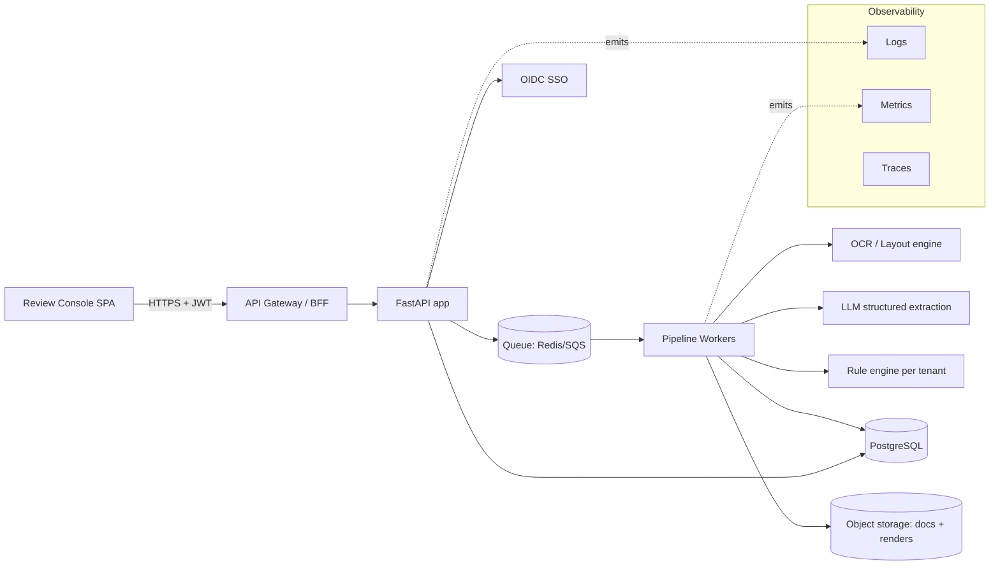

# intel2doc — Productization Plan & Production Requirements

> The plan referenced by the [README](../README.md): what it takes to turn this
> POC into a live, multi-tenant enterprise product — and the concrete gap between
> the two. This is the "accompanying plan for the full production requirements and
> tech stack."

---

## 1. Where we are (POC state, today)

The POC proves the product thesis end-to-end and is **runnable offline with zero API keys**:

- **Six-step pipeline** — Classify → Segment → Select → Extract → Validate → Route
  (`backend/app/pipeline/*`).
- **Four workflows, one engine** — Customs, Po2Pay, Contracts, Finance. Each is just a
  different set of schemas (`app/schemas/*.json`) + rulesets (`app/rules/rulesets.py`):
  | Workflow | Documents | Headline check |
  |---|---|---|
  | Customs | Commercial Invoice, Certificate of Origin | HS-code ↔ duty-rate consistency; CoO ↔ invoice cross-check |
  | Po2Pay | Purchase Order, Goods Receipt Note, Vendor Invoice | Three-way match / over-billing |
  | Contracts | GST Certificate | GSTIN check-digit validation |
  | Finance | Bank Statement | Running-balance reconciliation |
- **100% source traceability** — every `Field` carries a normalized `BoundingBox`.
- **Confidence + rule-based routing** — auto-approve vs. human review, with reasons.
- **Human-in-the-loop review UI** — React app with per-field confidence, source
  highlighting, inline correction, and re-routing (`frontend/`).
- **Optional API-key auth**, configurable CORS, SQLite persistence, Docker Compose,
  healthchecks, and a passing test suite (`backend/tests/`).

### What the POC intentionally does NOT do
Multi-tenancy, SSO/RBAC, a real OCR+LLM extractor, horizontal scale, audit-grade
compliance, model lifecycle, and a no-code rule/schema authoring surface. Those are
the productization work below.

---

## 2. Gap analysis (POC → Product)

| Capability | POC today | Production target |
|---|---|---|
| Extraction | Deterministic mock | OCR/layout (Azure DI / Textract / Document AI / PaddleOCR+LayoutLM) → LLM structured output → span mapping for bboxes |
| Ingestion | Filename → canned text | Real PDF/image/email/scan intake, virus scan, page rendering (PDF.js server-side), bundle boundary detection |
| Storage | SQLite file | PostgreSQL + object storage (S3/Blob) for documents, per-field change history, audit log |
| Auth | Single API key | OIDC SSO (Entra ID / Okta), JWT, per-tenant RBAC (roles: reviewer, approver, admin) |
| Multi-tenancy | None | Tenant isolation (row-level security or schema-per-tenant), per-tenant schemas/rules/thresholds |
| Rules & schemas | Python code | No-code rule/schema builder, versioned per tenant, safe-sandboxed expressions |
| Async & scale | Synchronous request | Queue/worker model (Celery/RQ/Arq + Redis, or cloud queue), autoscaling |
| Observability | None | Structured logs, metrics, traces, per-document audit timeline, dashboards |
| Compliance | None | SOC 2 / ISO 27001 controls, data retention, PII handling, encryption at rest/in transit |
| Delivery | Docker Compose | CI/CD, IaC, staged environments, blue/green or canary |

---

## 3. Target architecture



**Request flow (async):** upload → persist bytes to object storage → enqueue job →
worker runs the six steps → results + field-level provenance written to PostgreSQL →
UI polls/streams status → reviewer acts on the queue.

The six-step pipeline and the `Extractor`/`Rule` interfaces are **unchanged** from the
POC — only the implementations behind them harden. That is the core design bet.

---

## 4. Recommended tech stack

- **Backend:** Python 3.12, FastAPI, Pydantic v2, SQLAlchemy + Alembic (migrations).
- **Async:** Arq or Celery workers on Redis (or SQS + Lambda/ECS for cloud-native).
- **Extraction:** pluggable — Azure Document Intelligence / AWS Textract / Google
  Document AI for OCR+layout; an LLM (GPT-4o / Claude / Gemini) with structured
  output for field mapping; self-hosted PaddleOCR + LayoutLMv3 as a sovereign option.
- **Data:** PostgreSQL (primary), S3/Azure Blob (documents + page renders), Redis (queue/cache).
- **Frontend:** React 18 + Vite + TypeScript; PDF.js for real page rendering with the
  same normalized-coordinate bbox overlay used in the POC.
- **AuthN/Z:** OIDC (Microsoft Entra ID / Okta / Auth0), JWT, tenant-scoped RBAC.
- **Infra:** Docker; Kubernetes or ECS; Terraform IaC; GitHub Actions CI/CD.
- **Observability:** OpenTelemetry → Prometheus/Grafana + Loki/Tempo (or Datadog).

---

## 5. Data model (production, abridged)

- `tenant(id, name, settings)`
- `user(id, tenant_id, email, roles[])`
- `document(id, tenant_id, source_name, storage_uri, status, created_by, created_at)`
- `sub_document(id, document_id, doc_type, workflow, engine, route, min_confidence)`
- `field(id, sub_document_id, name, value, confidence, page, bbox, corrected, corrected_by)`
- `rule_result(id, sub_document_id, rule_id, severity, passed, detail)`
- `audit_event(id, tenant_id, actor, action, target, before, after, at)` — append-only.
- `schema_version(id, tenant_id, doc_type, definition, version, active)`
- `ruleset_version(id, tenant_id, doc_type, definition, version, active)`

Every reviewer action writes an `audit_event`; `field` keeps `corrected_by`/timestamp
for field-level change history.

---

## 6. Security & compliance requirements

- **Transport/at rest:** TLS 1.2+, encrypted DB + object storage (KMS-managed keys).
- **Secrets:** never in the repo; use a secrets manager (Key Vault / Secrets Manager).
- **Authorization:** tenant isolation enforced at the data layer (RLS or schema-per-tenant);
  RBAC checks on every endpoint; least-privilege service identities.
- **Input safety:** file type/size validation, AV scanning, PDF sanitization, and
  guarding the LLM path against prompt injection from document content.
- **PII/data governance:** classification, configurable retention & deletion, data
  residency options, redaction in logs.
- **Compliance track:** SOC 2 Type II / ISO 27001; audit-grade immutable event log;
  access reviews; pen testing. Maps to OWASP Top 10 mitigations across the app.

---

## 7. Extraction & MLOps

- **Provenance:** map every returned value back to source token spans to populate
  bounding boxes — the traceability guarantee must survive the real extractor.
- **Confidence calibration:** calibrate model scores so the routing threshold is
  meaningful; track precision/recall per field per document type.
- **Human feedback loop:** reviewer corrections become labeled data for evaluation
  sets and (optionally) fine-tuning; measure auto-approval rate and correction rate.
- **Evaluation harness:** golden datasets per workflow, regression gates in CI,
  drift monitoring in production.

---

## 8. Delivery roadmap

**Phase 0 — POC (done).** Offline, all four workflows, review UI, tests.

**Phase 1 — Productization foundation.**
PostgreSQL + Alembic; object storage; async workers; real OCR+LLM extractor behind
the existing interface; structured logging/metrics; CI/CD; IaC for one environment.

**Phase 2 — Enterprise readiness.**
OIDC SSO + tenant RBAC; multi-tenancy isolation; no-code schema/rule authoring with
versioning; audit timeline UI; autoscaling; staging + prod environments.

**Phase 3 — Compliance & scale.**
SOC 2 / ISO controls; data residency & retention; evaluation harness + drift
monitoring; performance/cost optimization; blue-green/canary releases.

---

## 9. Making it live

**Local / demo (today):**
```powershell
copy .env.example .env
docker compose up --build
# API http://localhost:8000/docs   UI http://localhost:5173
```
Set `API_KEY` in `.env` to require auth; set `CORS_ORIGINS` to lock down the UI origin.

**Cloud (Phase 1+):** containerize both services (backend image already production-shaped;
add an nginx multi-stage build for the frontend), push to a registry, provision managed
PostgreSQL + object storage + Redis via Terraform, deploy to ECS/AKS/GKE behind a
gateway with TLS and the OIDC integration, and wire CI/CD to run the test suite +
evaluation gates before promotion.

---

## 10. Success metrics

- **Straight-through rate** — % auto-approved without human touch.
- **Correction rate** — % of fields edited in review (extraction quality proxy).
- **Time-to-decision** — upload → routed.
- **Cost per document** — trending down as volume grows.
- **Escaped-defect rate** — factually wrong values that passed — target ~0 via rules.
